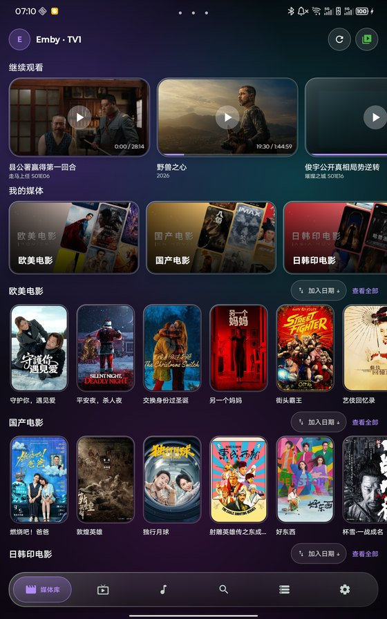
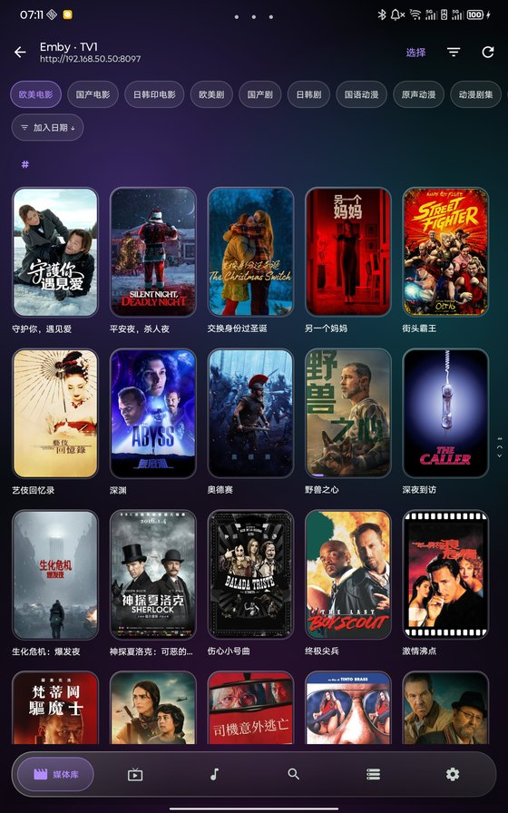
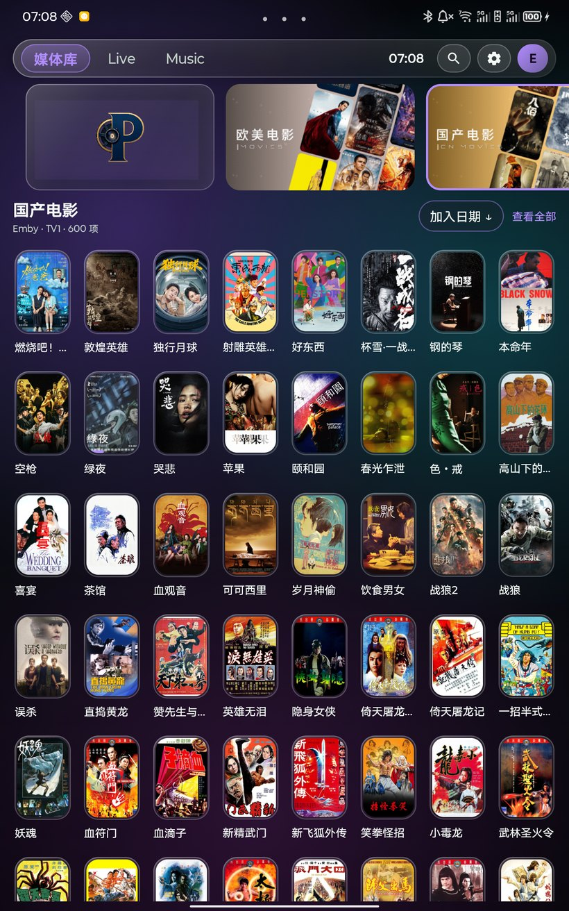
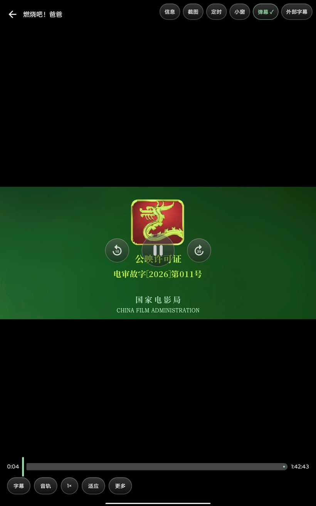

<div align="center">

# Playable

### 跨平台媒体播放器 · Android / Windows / iOS
#### 自研 PlayNative 内核，直连 `.strm` 媒体库

[简体中文](README.md) · [English summary](#english-summary)

[](LICENSE)
[](https://kotlinlang.org/)
[](docs/PORTING-SPEC.md)
[](https://github.com/lichangzhou/Playable)
[](https://github.com/lichangzhou/Playable)
[](https://github.com/lichangzhou/Playable)

</div>

---

**Playable** 是一个自研内核的跨平台媒体播放器。它不只播放本地文件 —— 它直接消费
`.strm` 媒体库，自动跟随 `302` 跳转，把网盘里的资源当成自己的媒体库来用。

- **自研 PlayNative 内核** —— 基于 FFmpeg + libass，硬解、PGS 字幕、HDR/DV 路由
- **平台隔离的架构** —— 核心层不含任何平台 SDK 头文件，跨端移植只换四个钩子
- **一套 UI 两个形态** —— 手机竖屏与 TV 横屏同源，遥控器焦点与触屏手势各自适配
- **媒体库 / Live / Music 三页签** —— 一台设备管完所有内容
- **直连 `.strm`** —— 解析单行 URL、跟随 302、交给内核起播

---

## 目录

- [界面](#界面)
- [功能](#功能)
- [平台状态](#平台状态)
- [内核架构](#内核架构)
- [生态：三个项目一起用](#生态三个项目一起用)
- [获取与构建](#获取与构建)
- [English summary](#english-summary)
- [License](#license)

---

## 界面

**手机版 · 首页** —— 媒体库横排、继续观看、分类入口。



**手机版 · 媒体库** —— 选库后直接浏览该库内容。



**TV 版 · 媒体库** —— 横屏布局，焦点导航按遥控器设计。



**TV 版 · 播放页** —— 硬解信息、字幕轨、音轨一目了然。



更多截图见 [`docs/assets/`](docs/assets/)。

---

## 功能

| 能力 | 说明 |
|---|---|
| **`.strm` 直连** | 读取单行 URL，解析、跟随 `302`、起播；对网盘签名链接透明处理 |
| **硬解** | Android 走 MediaCodec，Windows 走 D3D11VA / NVDEC，iOS 走 VideoToolbox |
| **字幕** | libass 渲染，支持 PGS 与内嵌字幕；HDR/DV 下的字幕兜底已做处理 |
| **音画同步** | 调度层自己控制上屏节奏钟，背压与音画同步在核心里完成 |
| **媒体库 / Live / Music** | 三个页签，一台设备管完所有内容 |
| **TV 双形态** | 同一套代码，靠 `isTv` 门控切换手机与 TV 两套布局 |
| **离线缓存** | 本地缓存与断点续播 |

---

## 平台状态

| 平台 | 状态 | 说明 |
|---|---|---|
| **Android · 手机** | ✅ 已发布 | v48 及以后版本，竖屏形态 |
| **Android · TV** | ✅ 已发布 | v54 及以后版本，横屏 + 遥控器焦点 |
| **Windows** | 🚧 移植中 | 内核钩子已定义，UI 壳按 Android 端 1:1 复刻 |
| **iOS / tvOS** | 🚧 移植中 | 同上 |

Windows 与 iOS 的移植清单见 [`docs/PORTING-SPEC.md`](docs/PORTING-SPEC.md)。

---

## 内核架构

内核在设计之初就做了平台隔离 —— 不是「Android 专用代码硬塞」，而是**核心层只认接口、
不认平台**：

| 接口 | 作用 | Android 后端 | Windows | iOS |
|---|---|---|---|---|
| `pn_surface` | 视频上屏 | ANativeWindow | HWND + GPU 纹理 | CVPixelBuffer / CALayer |
| `pn_audio_out` | 音频输出 | AAudio | WASAPI / PortAudio | AudioUnit / AVAudioEngine |
| `HwDecoder` | 硬件解码 | MediaCodec | D3D11VA / NVDEC | VideoToolbox |
| `pn_platform` | 日志与调试 | logcat + setprop | stderr / 文件日志 | os_log / UserDefaults |

因此：

- **平台无关层**（player / render / subtitle / demux / decode / audio）可以直接拷贝，
  不用改一行逻辑
- **需替换的只有四个钩子的后端实现**，核心调度逻辑（上屏节奏钟、音画同步、背压、
  PGS 兜底、HDR/DV 路由）全部原样复用

---

## 生态：三个项目一起用

Playable 是三个自建项目里负责**播放**的那一环：

| 项目 | 定位 | 仓库 |
|---|---|---|
| **[Docker-Link](https://github.com/lichangzhou/Docker-link)** | 运维整个栈：容器、镜像、卷、Compose、文件管理、Web 终端、远程节点、监控告警 | [lichangzhou/Docker-link](https://github.com/lichangzhou/Docker-link) |
| **[EvoLink](https://github.com/lichangzhou/Evolink)** | 治理媒体库：索引 Emby / Plex / Jellyfin / Playable、缺口比对、归档刮削、权重洗板、115 → 302 换链 | [Evolink](https://github.com/lichangzhou/Evolink) · [EvoLink-CN](https://github.com/lichangzhou/EvoLink-CN) |
| **Playable** | 播放端：Android / Windows / iOS | 本仓库 |

```
Docker-Link（跑起来） → EvoLink（理清楚） → Playable（看下去）
```

- **Docker-Link** 负责把整套装起来并盯着它跑
- **EvoLink** 产出 `.strm` 媒体库，并且是唯一一个能生产「可跟随 302 的签名链接」的项目
- **Playable** 直接消费这个媒体库，302 全程透明，用户感觉不到网盘的存在
- **Playable 同时也是 EvoLink 的索引源之一** —— 只在 Playable 上存在的作品不会被算成缺失

三个项目相互引用、各自独立。详见 [`docs/ECOSYSTEM.md`](docs/ECOSYSTEM.md)。

---

## 获取与构建

### 获取

Android APK 通过 [playable-apk](https://github.com/lichangzhou/playable-apk) 仓库分发（OTA 镜像）。

### 构建

> **当前说明**：本仓库公开的是**项目主页、界面规格与设计文档**。
> 完整的 Android 工程构建链依赖内部维护的 SDK 与原生依赖（FFmpeg 源码、NDK、
> 硬件编解码 AAR），暂未开源。移植与复刻所需的全部口径已经整理在
> [`docs/PORTING-SPEC.md`](docs/PORTING-SPEC.md) 中。

如果你想自己搭一个播放器，规格文档里写清了：

- 平台无关层要拷哪些文件
- 四个钩子分别怎么实现
- Android UI 的每个像素：颜色值、字号、动画参数
- 两个形态（手机 / TV）的分支口径

---

## English summary

**Playable** is a cross-platform media player for **Android, Windows and iOS** built on a
self-developed playback core (**PlayNative**, on top of FFmpeg and libass).

It does more than play local files: it consumes **`.strm` libraries** directly, resolves the
single-line URL, follows the `302` redirect and starts playback — so resources on a netdisk
behave exactly like a local library.

- **Hardware decoding** — MediaCodec on Android, D3D11VA / NVDEC on Windows, VideoToolbox on iOS
- **libass subtitles** including PGS, with a fallback path for HDR / Dolby Vision
- **Platform-isolated core** — the core layer contains no platform SDK headers; porting to
  a new platform means reimplementing four interface hooks, not rewriting the engine
- **One codebase, two shapes** — phone and TV layouts driven by an `isTv` gate
- **Media library / Live / Music** in three tabs

The core is already shipping on Android (phone and TV). Windows and iOS ports are in
progress, with the full porting checklist in [`docs/PORTING-SPEC.md`](docs/PORTING-SPEC.md).

### Part of a stack

- **[Docker-Link](https://github.com/lichangzhou/Docker-link)** — operate the containers
- **[EvoLink](https://github.com/lichangzhou/Evolink)** — maintain the library
- **Playable** — play it

---

## License

[MIT](LICENSE) —— 文档与本仓库内代码部分。APK 分发与商业授权另行约定。

© 2026 lichangzhou
